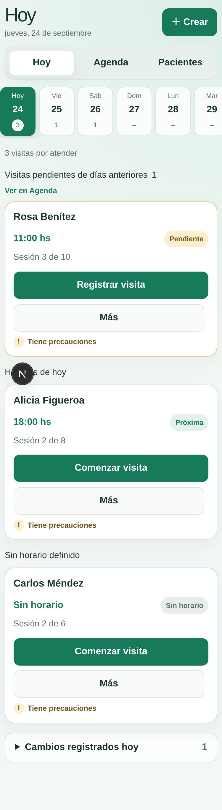
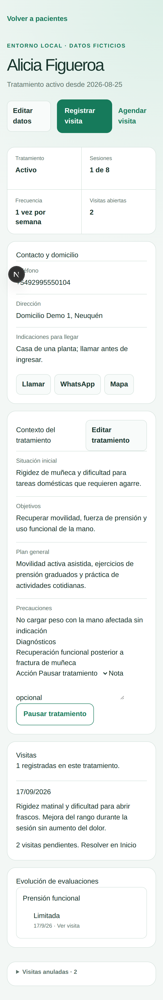
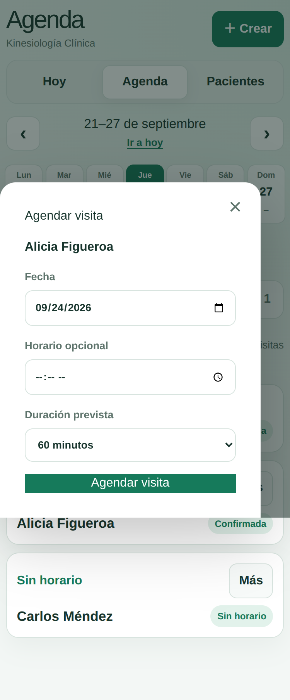
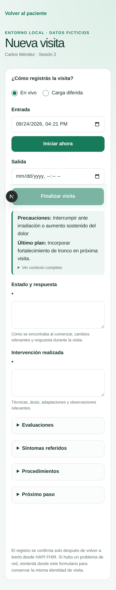

# Kinesiología Clínica

Aplicación privada para organizar pacientes, tratamientos y visitas de kinesiología domiciliaria. Esta etapa reemplaza de forma incremental la superficie `/admin` y está pensada para un profesional independiente.

> Registrar una vez. Comunicar y reportar sin volver a escribir.

## Estado del proyecto

La aplicación cuenta con una pantalla de inicio autenticada con **Hoy**, **Agenda** y **Pacientes**; administración de pacientes y tratamientos; agenda de visitas; registro de visitas en vivo o de forma diferida; evaluaciones funcionales y procedimientos; corrección o anulación justificada de visitas; y un borrador editable de resumen familiar que prepara texto para compartir por WhatsApp. Los datos clínicos se guardan en HAPI FHIR desde el servidor, nunca directamente desde el navegador.

El acceso usa passkeys para una cuenta profesional provisionada, con sesiones por dispositivo, revocación y códigos de recuperación. El ingreso con passkey se validó en Ubuntu y Android y se comprobó la revocación de sesión. Siguen pendientes las pruebas con un autenticador independiente, la recuperación completa y la revocación de una segunda passkey.

**Todos los datos usados actualmente en desarrollo, pruebas, demostraciones y documentación son inventados. No cargar datos reales.** El flujo clínico es un piloto online que solo se habilita localmente contra el HAPI descartable en `http://localhost:8081/fhir`; las rutas y escrituras clínicas están bloqueadas en Vercel. El antiguo `/admin` sigue siendo el respaldo operativo durante la migración.

Se implementaron períodos de sesiones e informes breves definitivos con PDF, renovación, cierre parcial y reemplazos conservando el original. La aceptación física del incremento está pendiente. Todavía no están implementados PWA, trabajo offline ni sincronización posterior. El resumen familiar no se persiste y abrir WhatsApp no envía el mensaje; hay que revisar el texto y confirmar el envío allí. El proyecto no está listo para datos clínicos reales.

Los contratos y la verificación están en [períodos e informes](docs/periodos-informes.md); la prueba en Ubuntu y Moto G15, en [pruebas físicas](docs/pruebas-fisicas-periodos.md).

## Recorrido de la aplicación

La pantalla **Hoy** reúne las visitas en curso, pendientes y previstas. **Agenda** permite consultar fechas y resolver visitas. **Pacientes** permite buscar y abrir fichas, donde se consulta el tratamiento y el historial. Desde una ficha se registra una visita con horarios, evolución breve, intervención y próximo paso; evaluaciones y procedimientos son opcionales.

En la interfaz, *visita* es el término principal. *Sesión* puede aparecer en resúmenes, e *intervención* describe el trabajo hecho dentro de una visita.

## Imágenes

Capturas reales de la aplicación en el entorno local de demostración. **Todos los nombres, datos de contacto y datos clínicos que aparecen son ficticios.**

<details>
<summary>Ver capturas de la aplicación</summary>

**Hoy — visitas pendientes y agenda del día**



**Ficha de paciente — tratamiento e historial ficticios**



**Agenda — calendario y diálogo para agendar una visita ficticia**



**Registro de visita — formulario en vivo con datos de demostración**



</details>

## Desarrollo local

Requiere Node.js 20.19 o superior y el HAPI FHIR descartable descrito en [`docs/local-fhir.md`](./docs/local-fhir.md).

```bash
npm install
cp -n .env.example .env.local
npm run dev
```

La aplicación queda disponible en `http://localhost:3000/inicio`. `GET /api/health` informa la disponibilidad del registro clínico sin revelar su URL ni datos sensibles.

Para cargar datos ficticios repetibles:

```bash
npm run seed:clinical-home
```

`npm run dev` apunta al HAPI descartable de `8081`. No uses `npm run dev:fhir-real` durante desarrollo o pruebas. Para acceder desde Android por HTTPS en la misma red, seguí [`docs/dev-lan.md`](./docs/dev-lan.md).

Para preparar una cuenta local, configurá las variables de `.env.example` en `.env.local`, generá un valor aleatorio para `AUTH_BOOTSTRAP_TOKEN` y registrá la primera passkey en `/ingresar`. Guardá los códigos de recuperación que se muestran una sola vez. La guía de dispositivos está en `/configuracion/dispositivos`.

## Comprobaciones

```bash
npm run lint
npm run test
npm run test:integration:fhir
npm run test:e2e
FHIR_BASE_URL=http://localhost:8081/fhir npm run build
```

## Documentación

- [Producto y alcance](./docs/product.md)
- [Arquitectura](./docs/architecture.md)
- [Privacidad y entornos](./docs/privacy.md)
- [Adaptador FHIR](./docs/fhir-adapter.md)
- [Índice de documentación](./docs/README.md)
